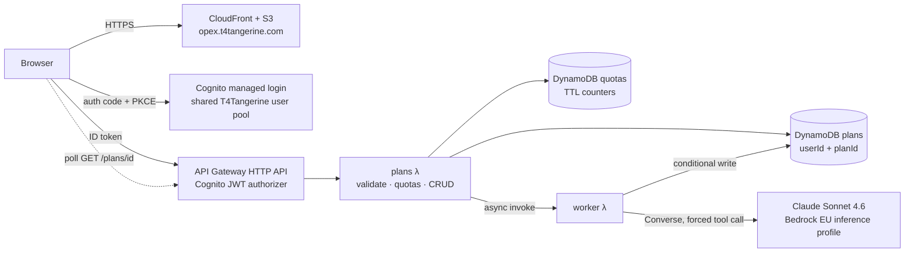

# OpEx Agent

**Turns a business goal into a resource plan: sub-goals with dependencies, roles and capacity, skills and hiring gaps, cost factors, the P&L line it moves, and risks. A signed-in app on AWS with Claude on Amazon Bedrock.**

Live: **[opex.t4tangerine.com](https://opex.t4tangerine.com)** (free account) · Method: [Goal Decomposition article](https://www.t4tangerine.com/blog/goal-decomposition), Part 3 of *Goal Planning That Actually Works* · Built by [T4Tangerine](https://www.t4tangerine.com)

---

## What it does

Input: a goal ("Cut Tier 1 first-response time from 4.2 to under 2 hours by the end of Q1"), the people you have (roles and headcount), a timeline in weeks, and the functions involved.

Output: a structured plan, saved to the user's account and downloadable as a PDF.

- **summary**: the goal restated in actionable terms
- **subGoals**: 3–6 steps, each with a duration and its dependencies
- **roles**: who works on it, how many, at what capacity, and why
- **hiringNeeded**: roles the team lacks, with priority
- **skills**, **estimatedDuration** and **costFactors** (European salary benchmarks)
- **ppiLine**: the P&L line it moves (Revenue, COGS, OpEx, CapEx) and in which direction
- **risks**: severity and mitigation

## Architecture



The app is four CDK stacks: `OpexIntelligence-Cert` (us-east-1, for CloudFront), `-Api`, `-Web`, and the legacy public endpoint (below). Everything else runs in `eu-central-1`, and the model runs through an EU cross-region inference profile, so data stays in the EU.

| Route | What it does |
|---|---|
| `POST /plans` | Validate input, check quotas, store the plan as `PENDING`, start the worker → `202 { planId }` |
| `GET /plans` | The caller's plans, newest first |
| `GET /plans/{planId}` | One plan with its inputs, and the result once `COMPLETE` |
| `DELETE /plans/{planId}` | Delete it |

## Engineering decisions

**Measured, then chose async.**
- A Sonnet plan takes **21–25 s** (about 1.8k tokens in, 2k out).
- API Gateway's HTTP API stops a request at **30 s**, which is too close to rely on.
- So `POST /plans` returns at once, a worker Lambda generates the plan, and the page polls. That also gives every user a saved history for free.
- *(The first version used a Lambda Function URL with a 90 s timeout. It worked, but it couldn't sit behind a Cognito authorizer or store history.)*

**One account across products.** The app adds its own client to the existing T4Tangerine Cognito user pool (shared with the [Stack Optimizer](https://github.com/najmanaaz/stack-optimizer)): sign up once, use both.
- **Sign-in:** authorization code flow with PKCE against the managed login page.
- **Tokens:** short-lived (1 h ID token, 30-day refresh token).

**Tenant isolation.**
- **User id:** every route takes the user id from the verified token's `sub`, never from the request.
- **Keys:** plans are keyed `(userId, planId)`.
- **Other users:** asking for someone else's plan returns "not found", by construction.

**Race-safe deletion.** The worker's final write is conditional (`attribute_exists(planId) AND status = PENDING`). A plan deleted while it is being generated is never brought back.

**Schema-enforced output.** The plan schema is a Bedrock tool (`submit_plan`) and the model is forced to call it, so the result is structured data validated against the schema. A shape check runs before anything is stored.

**Cost and abuse controls.**
- **Daily caps:** 20 plans per user per day and 300 in total, as DynamoDB counters with a conditional `ADD`, so concurrent requests can't overshoot. They expire on their own (TTL).
- **Input caps:** the goal is at most 2,000 characters, with at most 20 roles.
- **Throttling:** API Gateway stage throttling.
- **Budget alarm:** at 80% and 100% of a monthly budget, on everything tagged `app=OpexIntelligence`.

**Prompt-injection hygiene.** The user's goal is fenced in `<goal>` tags, and the system prompt treats it as data, never instructions. The only thing the model can do is fill in the plan schema.

**Least privilege, EU only.** Each function gets only the table actions it uses.
- **Worker:** can invoke one model, only through the EU inference profile.
- **App:** served from a private S3 bucket through CloudFront (Origin Access Control), with a strict CSP, HSTS and `frame-ancestors 'none'`.

**Observability without content.** Logs record route, outcome, latency, model and token counts, never the goal text. X-Ray tracing is on.

**Client-side PDF.** The plan is rendered off-screen in a print theme and sliced into A4 pages at card and list-item boundaries (html2canvas + jsPDF), with page numbers and a dated footer.

**Swappable model.** `lib/config.ts` holds the model id. Moving to Claude Sonnet 5.5 is a one-line change once it's enabled for the account.

### Legacy public endpoint

`lambda/simulate.ts` and `lib/goal-simulator-stack.ts` are the first version: an anonymous Lambda Function URL behind the blog article's embedded demo. It is being retired as the article moves to linking the signed-in app. It used per-visitor quotas keyed by an HMAC of the IP address, so no raw IPs were stored.

## Repository map

```
web/index.html              The app: sign-in, form, saved plans, plan view, PDF export
bin/app.ts                  CDK app
lib/config.ts               Region, model, domain, shared user pool, quotas, budget
lib/cert-stack.ts           HTTPS certificate (us-east-1, required by CloudFront)
lib/api-stack.ts            Cognito app client, HTTP API + JWT authorizer, plans/quota tables, plans + worker Lambdas
lib/web-stack.ts            Private S3 bucket + CloudFront with security headers, app-config.json
lib/bedrock-access.ts       IAM for invoking a model through a cross-region inference profile
lambda/plans.ts             The API: validate → quotas → store → start worker; list, get, delete
lambda/worker.ts            Generates one plan; conditional writes
lambda/generate.ts          Bedrock Converse with the forced submit_plan tool
lambda/plan.ts              Request validation, prompt, plan JSON schema, plan check (unit-tested)
lambda/quota.ts             Atomic DynamoDB quota counters (unit-tested)
test/                       node:test unit tests
```

## Run it

```bash
npm install
npm test
npx cdk bootstrap aws://<account>/eu-central-1 aws://<account>/us-east-1   # once
npx cdk deploy OpexIntelligence-Cert     # add the DNS validation record it asks for
npx cdk deploy OpexIntelligence-Api OpexIntelligence-Web -c alertEmail=you@example.com
```

Then point the app's domain at the `CloudFrontDomain` output (CNAME). `lib/config.ts` holds the domain and the Cognito user pool to attach to.

## Stack

AWS CDK (TypeScript) · Amazon Bedrock (Claude Sonnet 4.6, Converse API, tool use) · Lambda (Node 22, arm64) · API Gateway HTTP API + Cognito JWT authorizer · Cognito managed login (PKCE) · DynamoDB (conditional writes, TTL, PITR) · S3 + CloudFront (OAC, security headers) · ACM · CloudWatch · X-Ray · AWS Budgets

---

© 2026 T4Tangerine. All rights reserved. Published for viewing only; see [LICENSE](LICENSE).
