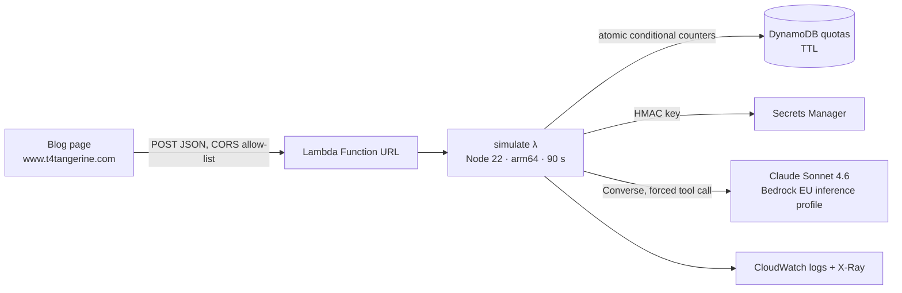

# Goal Simulator

**Turns a business goal into a resource plan: sub-goals with dependencies, roles and capacity, skills gaps, cost factors, the P&L line it moves, and risks. Runs on AWS with Claude on Amazon Bedrock.**

Live: **[try it in the Goal Decomposition article](https://www.t4tangerine.com/blog/goal-decomposition)** (Part 3 of *Goal Planning That Actually Works*) · Built by [T4Tangerine](https://www.t4tangerine.com)

---

## What it does

Input: a goal ("Cut Tier 1 first-response time from 4.2 to under 2 hours"), the team you have (roles and headcount), a timeline in weeks, and the functions involved.

Output: a structured plan that the article renders:

- **summary**: the goal restated in actionable terms
- **subGoals**: 3–6 steps, each with a duration and its dependencies
- **roles**: who works on it, how many, at what capacity, and why
- **hiringNeeded**: roles the team lacks, with priority
- **skills**, **estimatedDuration** and **costFactors** (European salary benchmarks)
- **ppiLine**: the P&L line it moves (Revenue, COGS, OpEx, CapEx) and in which direction
- **risks**: severity and mitigation

## Architecture



One CDK stack in `eu-central-1`; the model runs through an EU cross-region inference profile, so data stays in the EU.

## Engineering decisions

**Measured, then chose the front door.**
- A Sonnet plan takes **22–25 s** (≈1.8k tokens in, ≈2.1k out).
- API Gateway's HTTP API cuts integrations off at **30 s**, which is too close to rely on.
- A **Lambda Function URL** allows the full Lambda timeout (90 s here), with CORS restricted to the site's origins.

**Schema-enforced output.** The plan schema is a Bedrock tool (`submit_plan`) and the model is *forced* to call it, so the response is structured data validated against the schema. The original version parsed JSON from free text and stripped code fences. A light shape check runs before anything is returned.

**Cost and abuse controls** for a public, anonymous endpoint:
- **Per-visitor quota:** 10 runs per hour, and a **global cap** of 200 runs per day (about $8/day worst case at ~$0.04 per plan).
- **Atomic counters:** both quotas are DynamoDB counters with a conditional `ADD`, so concurrent requests can't overshoot, and they expire on their own (TTL).
- **Input caps:** the goal is at most 2,000 characters, with at most 20 roles of 80 characters each.
- **Budget alarm:** emails at 80% and 100% of a monthly budget on everything tagged `app=GoalSimulator`.
- **Optional concurrency cap:** a Lambda reserved-concurrency setting is ready for when the account's concurrency limit is raised. New AWS accounts start at 10 total, and AWS keeps 10 unreserved.

**Privacy by design.**
- **No raw IPs:** visitors are keyed by an **HMAC of their IP** with a secret generated in Secrets Manager.
- **No goal text in logs:** logs record outcome, latency and token counts only.

**Prompt-injection hygiene.** The user's goal is fenced in `<goal>` tags, and the system prompt treats it as data, never instructions. The only thing the model can do is fill in the plan schema.

**Least privilege.** The function may `UpdateItem` on one table, read one secret, and invoke one model, only through the EU inference profile (the foundation-model grant is conditioned on that profile's ARN).

**Swappable model.** `lib/config.ts` holds the model id. Moving to Claude Sonnet 5.5 is a one-line change once it's enabled for the account.

## Repository map

```
bin/app.ts                  CDK app
lib/config.ts               Region, model, origins, quotas, budget
lib/goal-simulator-stack.ts Function URL, Lambda, DynamoDB quotas, secret, logs, budget
lib/bedrock-access.ts       IAM for invoking a model through a cross-region inference profile
lambda/simulate.ts          Handler: validate → quotas → Bedrock Converse (forced tool) → check → JSON
lambda/plan.ts              Request validation, prompt, plan JSON schema, plan check (pure, unit-tested)
lambda/quota.ts             HMAC visitor keys and atomic DynamoDB quota counters (unit-tested)
test/                       node:test unit tests
```

## Run it

```bash
npm install
npm test                     # unit tests
npx cdk bootstrap            # once per account/region
npx cdk deploy -c alertEmail=you@example.com
```

The deploy prints `SimulatorUrl`. Point the page's `fetch` at it.

## Stack

AWS CDK (TypeScript) · Lambda (Node 22, arm64) · Lambda Function URLs · Amazon Bedrock (Claude Sonnet 4.6, Converse API, tool use) · DynamoDB (TTL, conditional writes) · Secrets Manager · CloudWatch · X-Ray · AWS Budgets

---

© 2026 T4Tangerine. All rights reserved. Published for viewing only; see [LICENSE](LICENSE).
